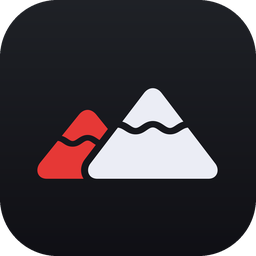
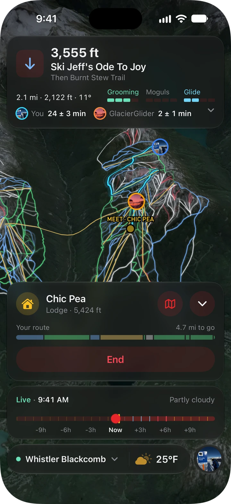
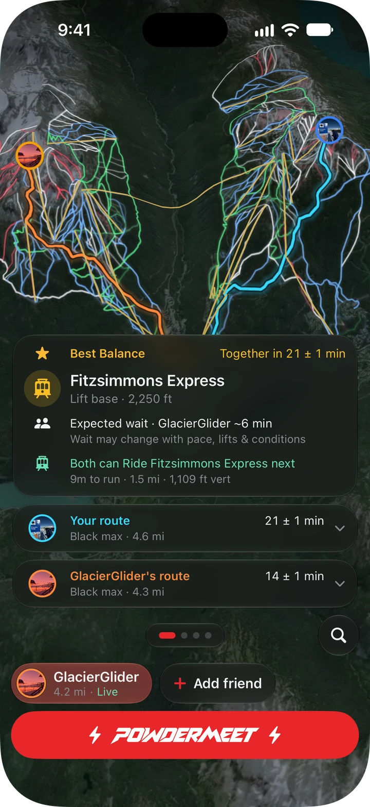
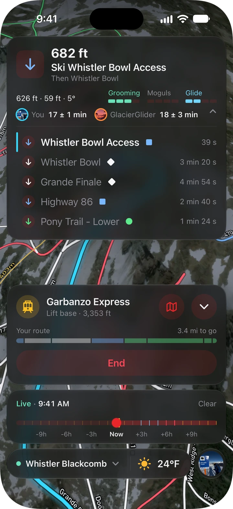
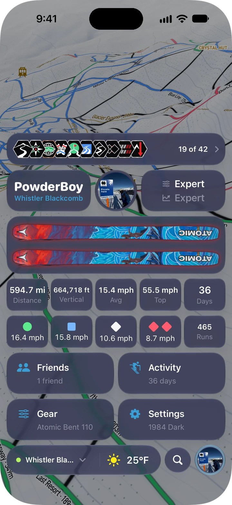
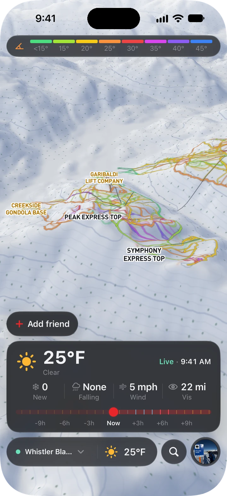

<h1>
  &nbsp;
  <picture>
    <source media="(prefers-color-scheme: dark)" srcset="Demos/wordmark-dark.png">
    
  </picture>
</h1>

**Find your crew on the mountain.**

[Website](https://zlichtman.com/open-source#powdermeet)

  
  
  
  
  

## Find Your Crew

The optimal place for two skiers to meet, on the resort's real lifts and trails. Live at
150+ Epic and Ikon resorts.

## Meet Up Faster

- **Every option:** tap a friend to see each place you could meet, ranked by when you'd
  both arrive.
- **Guided:** both phones lead you there, one step at a time.
- **Rerouted:** a lift or run closes, and the route changes.

## Routes That Know How You Ski

- **Your level:** set blue only, and every route avoids the blacks.
- **Your pace:** import runs from Slopes, GPX, TCX or FIT. Each is matched to the trail
  you skied, and your real speed sets every arrival time.
- **Your season:** days, runs, vertical and top speed, by mountain.

## On the Mountain

- **Friends:** on the map, live, with their photos.
- **Lifts:** open or closed, where the resort publishes it.
- **Weather:** snow, wind and visibility hour by hour, on a timeline you can scrub.
- **Map styles:** Satellite, Whiteout, Blueprint and PowderMeet, with the runs coloured
  by difficulty, steepness, the way they face, or how often you've skied them.

## Install

Public beta on TestFlight coming soon. iPhone, iOS 26 or later.

## Built With

SwiftUI and Swift 6. Maps by [Mapbox](https://www.mapbox.com), with resort data from
[OpenStreetMap](https://www.openstreetmap.org/copyright) contributors and
[OpenSkiMap](https://openskimap.org). Accounts and live meets on
[Supabase](https://supabase.com).

[Developer guide](docs/DEVELOPING.md) · [Third-party notices](docs/THIRD_PARTY_NOTICES.md)

## Privacy

- Your location is shared only with friends you accept, and stops when you leave the
  resort or sign out.
- Contacts stay on your phone. To suggest friends, the app checks scrambled (hashed) email
  addresses, never names or phone numbers.
- Deleting your account deletes all of your data.

[Privacy policy](docs/PRIVACY.md)

## Disclaimer

- Run ratings and lift status can be wrong.
- Always follow resort signs and ski patrol.
- You use PowderMeet at your own risk.

## License

[MIT](LICENSE)
